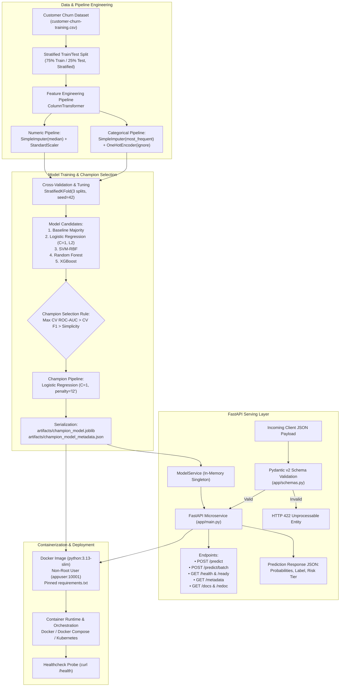

# Real-Time Customer Churn ML Inference REST API & Capstone Architecture

A production-grade Machine Learning inference microservice built with **FastAPI**, containerized via **Docker**, and powered by an automated, leak-free **Scikit-Learn Champion Pipeline** for real-time customer churn prediction.

---

## Table of Contents
1. [System Architecture](#system-architecture)
2. [Champion Model & Modeling Decisions](#champion-model--modeling-decisions)
3. [Project Directory Layout](#project-directory-layout)
4. [REST API Specification](#rest-api-specification)
5. [Local Development & Setup](#local-development--setup)
6. [Testing & Quality Assurance](#testing--quality-assurance)
7. [Dockerization & Container Deployment](#dockerization--container-deployment)
8. [Production Engineering & Capstone Considerations](#production-engineering--capstone-considerations)

---

## System Architecture

The end-to-end Machine Learning lifecycle—from raw tabular data and leak-free preprocessing to hyperparameter tuning, model artifact serialization, and containerized REST API serving—is illustrated below:



---

## Champion Model & Modeling Decisions

### 1. Business Problem
Identify subscription customers at risk of churn (`churned = 1`) versus retention (`churned = 0`) to trigger proactive retention campaigns, personalized offers, and account interventions.

### 2. Feature Schema & Target
| Feature | Type | Constraints | Description |
| :--- | :--- | :--- | :--- |
| `tenure_months` | Numeric (float/int) | $\ge 0$ | Length of customer relationship in months |
| `support_tickets`| Numeric (int) | $\ge 0$ | Cumulative support tickets raised |
| `monthly_spend_inr` | Numeric (float) | $\ge 0$ | Monthly subscription bill in INR |
| `last_login_days` | Numeric (float/int) | $\ge 0$ | Days elapsed since most recent active login |
| `plan_type` | Categorical (str) | `'Basic'`, `'Standard'`, `'Pro'` | Subscription plan tier |
| **`churned`** | **Binary Target** | `0` or `1` | **Target label (1 = Churned, 0 = Stay)** |

### 3. Leakage Prevention Protocol
* Preprocessing transformers (`SimpleImputer`, `StandardScaler`, `OneHotEncoder`) reside **inside** the scikit-learn `Pipeline`.
* In cross-validation folds, transformers are fitted strictly on each fold's training slice, completely preventing data leakage into validation folds.
* The champion model pipeline handles unseen categories at inference time (`OneHotEncoder(handle_unknown="ignore")`).

### 4. Selection Rationale
Out of 5 evaluated architectures (Dummy Baseline, Logistic Regression, SVM-RBF, Random Forest, XGBoost), **Logistic Regression ($C=1, \text{penalty}=\text{l2}$)** was selected as the **Champion Model** based on the objective hierarchy:
1. **Mean Cross-Validated ROC-AUC**
2. **Cross-Validated F1-Score**
3. **Simplicity / Occam's Razor** (linear interpretability, low latency, minimal inference footprint).

---

## Project Directory Layout

```
RabTech-Project/
├── app/
│   ├── __init__.py               # Package descriptor
│   ├── config.py                 # Application settings and environment variables
│   ├── main.py                   # FastAPI initialization, lifespan, CORS, and root routes
│   ├── model_service.py          # Model inference engine and singleton cache
│   ├── schemas.py                # Pydantic v2 schemas for request/response validation
│   └── routers/
│       ├── __init__.py           # Routers package
│       ├── health.py             # /health and /ready probe endpoints
│       └── predict.py            # /predict, /predict/batch, and /metadata endpoints
├── artifacts/
│   ├── champion_model.joblib     # Serialized Champion Pipeline (imputer + scaler + encoder + model)
│   └── champion_model_metadata.json # Training metadata, hyperparameters, and CV statistics
├── tests/
│   ├── __init__.py               # Test package
│   ├── conftest.py               # Pytest fixtures and mock client initialization
│   ├── test_health.py            # Tests for /health, /ready, and / endpoints
│   ├── test_predict.py           # Tests for prediction schema, probabilities, and risk tiers
│   ├── test_validation_errors.py # Tests for 422 HTTP responses and boundary validation
│   └── test_model_service.py     # Unit tests directly evaluating ModelService methods
├── Dockerfile                    # Production non-root Dockerfile with curl healthcheck
├── .dockerignore                 # Excludes cache, virtual environments, and temporary files
├── docker-compose.yml            # Docker Compose orchestration file
├── pytest.ini                    # Pytest configuration with pythonpath and warning filters
├── requirements.txt              # Pinned production Python dependencies
├── customer-churn-training (1).csv # Ground truth dataset
└── README.md                     # Comprehensive architecture and API documentation
```

---

## REST API Specification

### Base URL
* Local: `http://localhost:8000`
* Interactive API Documentation (Swagger UI): `http://localhost:8000/docs`
* Alternative Documentation (ReDoc): `http://localhost:8000/redoc`
* OpenAPI JSON: `http://localhost:8000/openapi.json`

---

### 1. Real-Time Single Prediction: `POST /predict`
Evaluates a single customer profile and returns churn probabilities, binary decision, and risk classification.

#### Request Headers
```http
Content-Type: application/json
```

#### Request Payload Example
```json
{
  "customer_id": "C015",
  "tenure_months": 2.0,
  "support_tickets": 4,
  "monthly_spend_inr": 499.0,
  "last_login_days": 21.0,
  "plan_type": "Basic"
}
```

#### Successful Response (`200 OK`)
```json
{
  "customer_id": "C015",
  "churn_prediction": 1,
  "churn_label": "Churn",
  "churn_probability": 0.939,
  "probabilities": {
    "stay": 0.061,
    "churn": 0.939
  },
  "risk_level": "High",
  "model_name": "Logistic Regression",
  "threshold": 0.5
}
```

#### cURL Command Example
```bash
curl -X POST "http://localhost:8000/predict" \
     -H "Content-Type: application/json" \
     -d '{
       "customer_id": "C015",
       "tenure_months": 2.0,
       "support_tickets": 4,
       "monthly_spend_inr": 499.0,
       "last_login_days": 21.0,
       "plan_type": "Basic"
     }'
```

---

### 2. Vectorized Batch Prediction: `POST /predict/batch`
Evaluates a list of customers concurrently in a single vectorized inference call.

#### Request Payload Example
```json
{
  "customers": [
    {
      "customer_id": "C001",
      "tenure_months": 2.0,
      "support_tickets": 4,
      "monthly_spend_inr": 499.0,
      "last_login_days": 21.0,
      "plan_type": "Basic"
    },
    {
      "customer_id": "C002",
      "tenure_months": 24.0,
      "support_tickets": 0,
      "monthly_spend_inr": 1499.0,
      "last_login_days": 1.0,
      "plan_type": "Pro"
    }
  ]
}
```

#### Successful Response (`200 OK`)
```json
{
  "total_records": 2,
  "predictions": [
    {
      "customer_id": "C001",
      "churn_prediction": 1,
      "churn_label": "Churn",
      "churn_probability": 0.939,
      "probabilities": { "stay": 0.061, "churn": 0.939 },
      "risk_level": "High",
      "model_name": "Logistic Regression",
      "threshold": 0.5
    },
    {
      "customer_id": "C002",
      "churn_prediction": 0,
      "churn_label": "Stay",
      "churn_probability": 0.01,
      "probabilities": { "stay": 0.99, "churn": 0.01 },
      "risk_level": "Low",
      "model_name": "Logistic Regression",
      "threshold": 0.5
    }
  ]
}
```

---

### 3. Health & Readiness Probes

#### `GET /health` (Liveness)
Returns 200 OK if service is up and running.
```json
{
  "status": "healthy",
  "model_loaded": true,
  "app_name": "Customer Churn Prediction API",
  "version": "1.0.0",
  "uptime_seconds": 45.2
}
```

#### `GET /ready` (Readiness)
Verifies that the champion model pipeline is resident in memory. Returns `200 OK` when ready, or `503 Service Unavailable` if the model failed to load.

---

### 4. Model Metadata: `GET /metadata`
Introspects champion model configuration and training specifications.
```json
{
  "champion": "Logistic Regression",
  "best_params": {
    "C": 1,
    "penalty": "l2"
  },
  "features": [
    "tenure_months",
    "support_tickets",
    "monthly_spend_inr",
    "last_login_days",
    "plan_type"
  ],
  "target": "churned",
  "selection_rule": "max mean CV ROC-AUC, tie-break CV F1, then simplicity",
  "cv": "StratifiedKFold(n_splits=3, shuffle=True, random_state=42)",
  "n_train": 9,
  "n_test": 3
}
```

---

## Local Development & Setup

### Prerequisites
* Python 3.12 or 3.13

### 1. Initialize Virtual Environment
```bash
# Create virtual environment
python3 -m venv .venv

# Activate virtual environment
source .venv/bin/activate
```

### 2. Install Dependencies
```bash
pip install -r requirements.txt
```

### 3. Run FastAPI Application
```bash
uvicorn app.main:app --host 0.0.0.0 --port 8000 --reload
```
Access the interactive documentation at `http://localhost:8000/docs`.

---

## Testing & Quality Assurance

The test suite covers:
* **Schema Validation & Integrity**: Correct field types, probability bounds ($0.0 \le p \le 1.0$), and class sum consistency ($p_{\text{stay}} + p_{\text{churn}} = 1.0$).
* **HTTP Response Codes**: `200 OK` for valid queries, `422 Unprocessable Entity` for negative values or missing fields, `503 Service Unavailable` when models are unloaded.
* **Edge Cases & Generalization**: Graceful handling of unobserved plan tiers (`EnterpriseVIP`) without crashing.
* **Batch Performance**: Consistency across single and batch prediction results.

### Execute Tests
```bash
.venv/bin/pytest -v
```

### Test Results
```
tests/test_health.py::test_root_endpoint PASSED                          [  5%]
tests/test_health.py::test_health_endpoint PASSED                        [ 10%]
tests/test_health.py::test_ready_endpoint PASSED                         [ 15%]
tests/test_model_service.py::test_model_service_load_and_predict PASSED  [ 21%]
tests/test_model_service.py::test_model_service_risk_levels PASSED       [ 26%]
tests/test_model_service.py::test_model_service_batch PASSED             [ 31%]
tests/test_model_service.py::test_model_service_unloaded_raises PASSED   [ 36%]
tests/test_predict.py::test_predict_high_risk_customer PASSED            [ 42%]
tests/test_predict.py::test_predict_low_risk_customer PASSED             [ 47%]
tests/test_predict.py::test_predict_without_customer_id PASSED           [ 52%]
tests/test_predict.py::test_predict_unseen_plan_type_handled_gracefully PASSED [ 57%]
tests/test_predict.py::test_predict_batch_endpoint PASSED                [ 63%]
tests/test_predict.py::test_api_prefix_route PASSED                      [ 68%]
tests/test_predict.py::test_get_model_metadata PASSED                    [ 73%]
tests/test_validation_errors.py::test_missing_required_fields PASSED     [ 78%]
tests/test_validation_errors.py::test_negative_numerical_values_rejected PASSED [ 84%]
tests/test_validation_errors.py::test_invalid_data_types PASSED          [ 89%]
tests/test_validation_errors.py::test_empty_json_payload PASSED          [ 94%]
tests/test_validation_errors.py::test_empty_batch_rejected PASSED        [100%]

============================== 19 passed in 2.14s ==============================
```

---

## Dockerization & Container Deployment

The container uses an unprivileged non-root user (`appuser:10001`), official slim Python base image, pinned dependencies, and an integrated Docker `HEALTHCHECK`.

### 1. Build Docker Image
```bash
docker build -t churn-inference-api:1.0.0 .
```

### 2. Run Docker Container
```bash
docker run -d \
  --name churn-ml-service \
  -p 8000:8000 \
  churn-inference-api:1.0.0
```

### 3. Verify Container Health
```bash
docker inspect --format='{{json .State.Health.Status}}' churn-ml-service
```
Expected output: `"healthy"`.

### 4. Deploy with Docker Compose
```bash
docker compose up -d
```
To stop the service:
```bash
docker compose down
```

---

## Production Engineering & Capstone Considerations

### 1. Low Latency & High Concurrency
* **In-Memory Pipeline Cache**: The champion pipeline is loaded into memory during FastAPI startup via `lifespan`, eliminating per-request deserialization overhead.
* **Vectorized Processing**: Batch requests are transformed and scored using vectorized NumPy and Pandas arrays.
* **Non-blocking ASGI Architecture**: FastAPI running on Uvicorn enables high throughput with low memory consumption.

### 2. Observability & Performance Metrics
* **Request Processing Time**: Every response contains an `X-Process-Time` HTTP header recording latency down to microsecond resolution.
* **Health and Readiness Endpoints**: `/health` and `/ready` enable integration with Kubernetes liveness and readiness probes or AWS ALB target group health checks.

### 3. Model Monitoring & Drift Mitigation
* **Data Drift**: Continuous tracking of incoming feature distributions (`tenure_months`, `support_tickets`, `monthly_spend_inr`) against baseline statistics using metrics like Population Stability Index (PSI) or Kolmogorov-Smirnov test.
* **Concept Drift**: Tracking discrepancies between predicted churn probabilities and subsequent actual cancellations to trigger automated retraining pipelines.

### 4. Enterprise Security
* **Non-Root Execution**: Container runs under UID 10001 (`appuser`), minimizing attack surface.
* **Input Sanitization & Schema Bounds**: Pydantic validates boundaries on all numeric inputs (rejecting negative tenure, tickets, or spend with HTTP 422).
* **Exception Shielding**: Internal exceptions are caught by a global middleware handler to prevent leaking internal stack traces.
